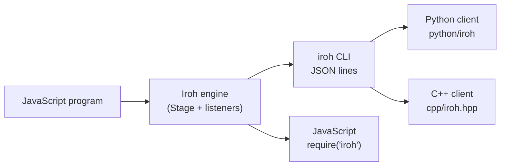

<p align="center">
  <a href="https://github.com/andyle777/IrohRedux/blob/master/LICENSE"></a>
  
  = 18" />
  = 3.9" />
  
  
  
</p>

<p align="center">
  <b>Watch your code run. Change it while it runs.</b><br/>
  IrohRedux is a dynamic code analysis tool for JavaScript — record your code flow
  in realtime, intercept runtime information, and manipulate program behaviour
  on the fly. And now you don't even have to write JavaScript to use it.
</p>

<p align="center">
  <a href="//github.com/andyle777/IrohRedux/blob/master/GETTING_STARTED.md">Getting Started</a> ·
  <a href="//github.com/andyle777/IrohRedux/blob/master/API.md">API</a> ·
  <a href="//github.com/andyle777/IrohRedux/blob/master/CHANGELOG.md">Changelog</a>
</p>

---

### Why dynamic analysis?

Static analysis (Babel, ESLint) reads your code. IrohRedux *runs* it — and tells you
what actually happened: which functions were called with what, which branches
were taken, what every variable held, moment by moment. That data only exists
at runtime, and Iroh Redux hands it to you while the code is still running, so you
can capture it, visualize it, or **change values mid-flight** and watch the
program react.

```js
const stage = new Iroh.Stage(`
  function factorial(n) {
    if (n === 0) return 1;
    return n * factorial(n - 1);
  };
  factorial(3);
`);
stage.addListener(Iroh.CALL).on("before", e => console.log("call", e.name, e.arguments));
stage.addListener(Iroh.CALL).on("after", e => console.log("call end ->", e.return));
eval(stage.script);
```

```
call factorial ( [3] )
  call factorial ( [2] )
    call factorial ( [1] )
      call factorial ( [0] )
        if
        if end
      call factorial end -> [1]
    call factorial end -> [1]
  call factorial end -> [2]
call factorial end -> [6]
```

### One engine, three languages

The engine is JavaScript, but the `iroh` CLI streams its trace events as
JSON lines — one event per line — so Python and C++ speak the same protocol
through thin clients. And since 0.9.0, Python and C++ programs trace
natively through that same CLI, with the same event shape — so one
analysis pipeline works on all three languages. No rewrites, no bindings
to compile, no second engine.



#### JavaScript — the engine itself

```js
import Iroh from "iroh";

// The quick way: one call, events plus result.
const { events, result } = Iroh.trace(code, { events: ["CALL", "IF"] });
// For async programs: await Iroh.traceAsync(code, options).
// Top-level await works there too: await Iroh.traceAsync("await Promise.resolve(42);").

// Modules: imports, import attributes, import.meta, dynamic import().
// Result is the live module namespace object.
const mod = await Iroh.traceModule(`
  import data from "./data.json" with { type: "json" };
  export const total = data.n + 1;
`, { filename: "./app.mjs" }); // filename: relative imports resolve against it
// mod.result.total === data.n + 1

// Decorators parse and trace — the decorator calls fire CALL events.
const dec = Iroh.trace(`
  function log(m, ctx) { return m; }
  class C { @log greet() { return "hi"; } }
  new C().greet();
`);
```
// The classic way: a Stage with live listeners.
const stage = new Iroh.Stage(code);
stage.addListener(Iroh.CALL).on("before", e => { /* e.name, e.arguments, e.hash, e.indent */ });
eval(stage.script);
```

TypeScript types ship in the package (`index.d.ts`) — no `@types` package
needed. The parser runs at the newest language level Acorn supports, with
hashbangs, RegExp `v` flags and modifiers, and `using` declarations all
traced.

#### CLI — trace any program, pipe the events anywhere

```sh
node cli/iroh.js program.js --events CALL,IF
cat program.js | node cli/iroh.js            # stdin works too
```

```json
{"type":"event","event":"FUNCTION_CALL","category":"CALL","trigger":"before","hash":11,"indent":1,"name":"factorial","arguments":[3],"external":false}
{"type":"event","event":"FUNCTION_CALL_END","category":"CALL","trigger":"after","hash":11,"indent":1,"name":"factorial","return":6,"arguments":[3],"external":false}
{"type":"result","value":6}
```

`--events ALL` is the default; `--no-result` skips the result line. Parse and
runtime errors come back as a final `{"type":"error",...}` line with a
non-zero exit code, and async programs are awaited before the result line.
Modules trace too: `.mjs` files are detected automatically, or pass
`--module` — relative imports resolve against the traced file.

Python and C++ trace natively through the same command (0.9.0):
`node cli/iroh.js program.py` or `program.cpp` — `--lang python|cpp`
forces it, the extension infers it. `--analyze` and `--scan` work for all
three languages; `--module` stays JavaScript-only. See the 0.9.0 section
below for what each tracer sees and what it honestly cannot.

#### Python — `from iroh import run` — and trace Python itself (0.9.0)

```python
from iroh import run

events, result = run("[1, 2, 3].map(v => v * 2);", events=["VAR"])
# result == [2, 4, 6]
```

Stdlib only, needs Node.js and the CLI — see [`python/`](python/).

The same client traces Python programs natively now:

```python
from iroh import trace_python, scan_python

events, _ = trace_python("def f(n):\n    return f(n-1) if n else 1\n\nf(3)\n")
# events: FUNCTION_CALL / FUNCTION_ENTER / FUNCTION_CALL_END / FUNCTION_LEAVE,
# with names, arguments, return values, file and line numbers
scan = scan_python("s = 0\nfor i in range(150):\n    s += i\n")
# scan["findings"][0]["code"] == "HOT_LOOP"
```

Or the CLI directly: `node cli/iroh.js program.py --analyze`.

#### C++ — one header, no dependencies — and trace C++ itself (0.9.0)

```cpp
#include "iroh.hpp"

iroh::Client client;
auto trace = client.run("[1, 2, 3].map(v => v * 2);", {"VAR"});
// trace.result.as_array() == [2, 4, 6]
```

Header-only C++17, with a minimal JSON parser built in — see [`cpp/`](cpp/).

The same header traces C++ programs natively now, no Node needed:

```cpp
#include "iroh.hpp"

iroh::native::Tracer tracer;
auto t = tracer.trace_code("int add(int a, int b) { return a + b; }\nint main() { return add(2, 3); }\n");
// t.events: FUNCTION_CALL / FUNCTION_ENTER / ... for main and add(int,int)
// t.exit_code == 5
```

Or the CLI: `node cli/iroh.js program.cpp --scan`. v1 is
function-level only — `-finstrument-functions` gives no loop/branch
events, so a C++ trace has no `LOOP_TEST`/`IF_TEST`; the scorecard scores
that honestly (coverage 2 of 30 categories).

### Analyze the trace — and translate the program (0.8.0)

A trace is data. `Iroh.analyze()` turns it into findings and a scorecard
for the toolkit's own run — deterministic rules, no LLM, no network:

```js
const { events, result, analysis } = Iroh.analyzeTrace(`
  let s = 0;
  for (let i = 0; i < 150; i++) { s += i; }
  s;
`);
// analysis.findings: [{ code: "HOT_LOOP", severity: "warning",
//   message: "Loop entered 150 times (threshold 100).",
//   evidence: { hash: 1, kind: "ForStatement", iterations: 150, tests: 151, threshold: 100 },
//   neuron: { label: "hot", score: 0.0259 } }, ...]
// analysis.scores.coverage: { fired: 9, total: 30, value: 0.3, ... }
// analysis.scores.fidelity: { observedRegions, missingRegions,
//   blindSpotStatements, totalRegions, value, knownBlindSpots }
// analysis.scores.overhead: { events, statements, regions,
//   eventsPerStatement, eventsPerRegion, value, denominator: "statements" }
```

Finding codes: `HOT_LOOP`, `ZERO_ITERATION_LOOP`, `DEEP_RECURSION`,
`REPEATED_SEQUENCE`, `ONE_SIDED_BRANCH`, `THROWING_PATH` — every finding
cites its evidence (counts, names, hashes). The neuron is a tiny
perceptron in pure JS (`Iroh.classifyWindow(events)` returns the label,
score, and the five feature values, so it is inspectable, not a black
box). The CLI appends the same analysis with `--analyze`. See
`API.md` for the full scorecard shape.

The same trace evidence also drives the hybrid translation engine —
static AST plus the runtime types, values, and branch outcomes the trace
saw. JavaScript goes to Python or C++; Python and C++ come back to
JavaScript (static-only by design — the reverse legs translate from
source alone; native Python/C++ tracers exist since 0.9.0, but the
translation legs do not use them):

```js
const { code, report } = Iroh.translate(
  "function add(a, b) { return a + b; } console.log(add(2, 3));",
  { to: "python" }
);
// code: "def add(a, b):\n    return a + b\n\nprint(add(2, 3))\n"
// report: { ok: true, from: "javascript", to: "python", staticOnly: false,
//   clean: [...], assumptions: [...], unsupported: [], notes: [...] }
```

Unsupported constructs are reported in `report.unsupported`, never
silently mistranslated — the emitted code raises at that point, loudly.
The CLI translates too: `node cli/iroh.js program.js --translate python`
(one `{"type":"translation",...}` line, exit 1 when anything was
unsupported), and `--from` is inferred from `.py` / `.cpp` files. The
reverse legs stay static-only by design — native Python/C++ tracers
exist since 0.9.0, but translation does not use them.

### Trace Python and C++ natively, and scan any trace (0.9.0)

Python traces with `sys.settrace` plus AST instrumentation of loops,
branches, and `except` handlers, so the same findings fire: a Python
hot loop analyzes to `HOT_LOOP` (150 iterations, 151 tests), a caught
exception to `THROWING_PATH`, a deep call stack to `DEEP_RECURSION`.
C++ traces with `-finstrument-functions` — function-level only in v1,
names resolved by `dladdr` + `__cxa_demangle` with a `.symtab` fallback
for local symbols (lambdas, `static` and anonymous-namespace
functions), unresolved names carried as `null` with the raw address,
never a faked name. Honest limits:
Python sees no per-assignment events (every assignment is a blind spot),
only the target file is traced, comprehensions/`async for`/lambdas are
not loop/branch instrumented; C++ sees no loop/branch/line events at
all, one `.cpp` file, `-O0` (inlined functions get no hooks). The full
list is in the CHANGELOG.

And the scan mode, for AI consumers: one command, one compact document,
no event flood:

```sh
node cli/iroh.js program.py --scan
node cli/iroh.js program.cpp --scan
node cli/iroh.js program.js --scan
```

```json
{"type":"scan","vectors":{"features":{"calls":0,"depth":0,"repeat":0.9868421052631579,"imbalance":0,"mix":1,"coverage":0.0333,"events":152},"vector":[0,0,0.9868421052631579,0,1,0.0333],"names":["calls","depth","repeat","imbalance","mix","coverage"]},"findings":[{"code":"HOT_LOOP","severity":"warning","message":"Loop entered 150 times (threshold 100).","evidence":{"hash":400712668,"kind":"For","iterations":150,"tests":151,"threshold":100},"neuron":{"label":"hot","score":0.0529}}],"scores":{...},"summary":{"events":152,"findings":1,"warnings":1,"infos":0,"maxCallDepth":0,"distinctRegions":1,"language":"python","neuron":{"label":"hot","score":0.0529},"findingsTruncated":0}}
```

The document is `{ vectors, findings, scores, summary }`: the trace
refracted into a deterministic feature vector (named features, all in
[0, 1] — the 0.8.0 neuron features plus coverage), the findings with
evidence, the scorecard with denominators on every number, and a summary
with the language, the neuron classification, and `findingsTruncated`
(findings are capped at 200 by default; the count of dropped ones is
reported, never hidden). The raw events ride along only with
`--include-events`. A 20,000-iteration loop (100k+ raw events) scans to
under 2% of the raw JSON bytes; scanning the same program twice gives
byte-identical output. These are FEATURE VECTORS, not LLM embeddings —
no model, no vector DB, no new dependencies. `Iroh.scanTrace(code)`,
`Iroh.toVector(events)`, and `Iroh.cosineSimilarity(a, b)` /
`Iroh.euclideanDistance(a, b)` are the library forms; identical traces
have distance exactly 0. Same schema for JS, Python, and C++.

### Watch it live (0.9.0)

Scan is analyze-after-the-fact. The live wire is analysis WHILE the
program runs — an AI watches the program and gets findings the moment
they trip:

```sh
node cli/iroh.js program.js --live
```

```json
{"type":"live-finding","code":"HOT_LOOP","severity":"warning","message":"Loop entered 100 times (threshold 100).","evidence":{"hash":1,"kind":"ForStatement","iterations":100,"tests":100,"threshold":100},"neuron":{"label":"hot","score":0.0251,"features":{...}},"firedAt":505}
```

The finding fired at event 505 of 763 — the loop had only run 100
iterations when the AI was told, not 150. Then a final
`{"type":"live-summary",...}` line carries the batch-equal findings
(the final tally: 150 iterations), the scorecard, and the vector. The
library form is `Iroh.liveAnalyzer(options)` with `.feed(event)` and
`.snapshot()` / `.findings()` / `.finish()`. Two findings need the
complete trace — `ZERO_ITERATION_LOOP` (a loop could still be entered)
and `ONE_SIDED_BRANCH` (a later test could take the other arm) — so
they fire at stream end with a `note` saying so, never a wrong early
call. The fired findings' codes always equal the batch `analyze()`
codes on the same complete trace, and the summary IS the batch
analysis, so live vs batch agreement holds by construction. Same
events give the same findings in the same order, twice. For Python
and C++ the live lines print after the run, because the native tracers
buffer their events; for JavaScript they stream as the program runs.

### What you get

- **Every event, live.** Calls, ifs, loops, assignments, allocations, awaits —
  with names, values, indentation, and the hash of the exact code location.
- **Values you can touch.** Listeners can read *and replace* arguments,
  return values, and variables while the program runs.
- **Modern JavaScript.** ES2022, arrows, optional chaining, nullish
  coalescing, private fields, async/await — all traced, all tested.
- **Three languages, one protocol.** JavaScript, Python, and C++ all consume
  the same JSON event stream — and since 0.9.0, Python and C++ trace
  natively (Python via `sys.settrace` + AST, C++ via
  `-finstrument-functions`, function-level in v1), so one analysis
  pipeline works on all three.
- **Analysis, not just events.** Deterministic findings (hot loops, deep
  recursion, one-sided branches, throwing paths) plus a toolkit scorecard
  with denominators on every number — and a tiny inspectable perceptron
  that classifies a trace window hot vs normal.
- **Scan mode for AI.** `--scan` (or `Iroh.scanTrace()`) turns trace →
  analyze → vector into ONE compact JSON document `{ vectors, findings,
  scores, summary }` — bounded, deterministic, same schema in all three
  languages. Vectors are deterministic feature vectors, not LLM
  embeddings.
- **Translation, both ways.** JavaScript to Python and C++, Python and C++
  back to JavaScript — hybrid (AST + trace evidence) out of JavaScript,
  static-only coming back, with an honest report of what translated, what
  needed an assumption, and what could not be translated.
- **No surprises.** 275 tests (241 Node + 25 Python + 9 C++), `npm test` runs
  them all, plus a TypeScript type test (`npm run test:types`). Zero runtime
  dependencies in the engine beyond Acorn, astring, and acorn-walk.

### Installation

```sh
npm install iroh
```

Or clone and build from source:

```sh
git clone https://github.com/andyle777/IrohRedux.git
cd IrohRedux
npm install
npm run dist        # builds dist/iroh-node.js, dist/iroh-node.es.mjs, dist/iroh-browser.js
npm test            # 275 tests: 241 Node + 25 Python + 9 C++
```

The Python client installs with `pip install -e python/`; the C++ client is
a single header — just `#include "iroh.hpp"`.

### Learn more

- [Getting started](//github.com/andyle777/IrohRedux/blob/master/GETTING_STARTED.md) — worked examples you can run locally.
- [API](//github.com/andyle777/IrohRedux/blob/master/API.md) — the full listener and event reference, including `Iroh.assert` / `Iroh.log` and the `INSTR` / `CATEGORY` / `OP` label tables.
- [Changelog](//github.com/andyle777/IrohRedux/blob/master/CHANGELOG.md) — what changed in 0.4.0, 0.5.0, 0.5.1, 0.6.0, 0.7.0, 0.8.0, and 0.9.0.

---

*IrohRedux is a fork of Felix Maier's [Iroh](https://github.com/maierfelix/Iroh)
0.3.0 (2018), fixed and extended. The core idea is his; the 0.4.0 fixes, the
0.5.0 CLI and polyglot clients, the 0.5.1 polish, the 0.6.0 syntax and
modern SDK, and the 0.7.0 modules, top-level await, and decorators, and
the 0.8.0 analysis layer and translation engine, the 0.9.0 native
Python/C++ tracers, vector refracting, scan mode, and live wire are the fork's.*
