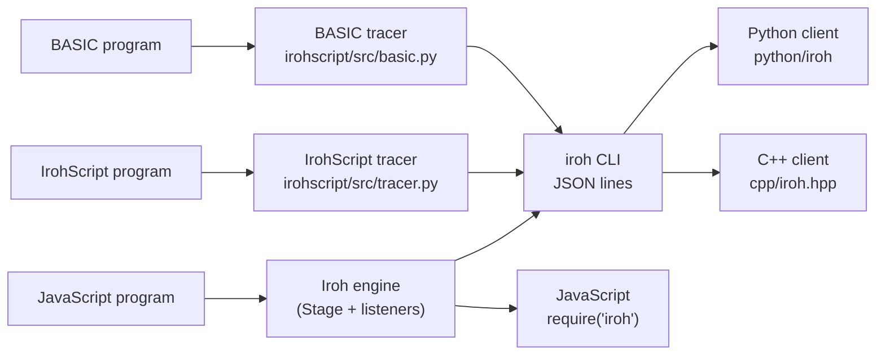

<p align="center">
  <a href="https://github.com/andyle777/IrohRedux/blob/master/LICENSE"></a>
  
  = 22" />
  = 3.9" />
  
  
  
</p>

<p align="center">
  <b>Watch your code run. Change it while it runs.</b><br/>
  <a href="//github.com/andyle777/IrohRedux/blob/master/GETTING_STARTED.md">Getting Started</a> ·
  <a href="//github.com/andyle777/IrohRedux/blob/master/API.md">API</a> ·
  <a href="//github.com/andyle777/IrohRedux/blob/master/CHANGELOG.md">Changelog</a> ·
  <a href="https://github.com/andyle777/IrohRedux/releases">Releases</a>
</p>

---

### What it is

IrohRedux runs your program and tells you what actually happened — which
functions were called with what, which branches were taken, what every
variable held, moment by moment — then lets you change values mid-flight
and watch the program react. It traces JavaScript, Python, C++,
IrohScript and BASIC through one engine and one event format, analyzes
the trace into findings (hot loops, deep recursion, one-sided branches,
throwing paths), translates programs between all five languages, and can
find the inputs that drive a program down each branch. No LLM, no
network, no model — deterministic rules over a trace.

### Releases

Two releases, both on the
[Releases page](https://github.com/andyle777/IrohRedux/releases):

- **1.0.1 — the solid base.** The all-generations audit-and-patch pass
  over 0.4.0–1.0.0: every known limitation re-read and re-probed, the
  real bugs fixed (translator `%` and number formatting, director
  member and scoped sets, `directAsync`/`directModule`, decorated
  computed keys, Python per-assignment events). 348 tests (314 Node +
  25 Python + 9 C++).
- **1.1.1 — the patch.** The trace memory release: a finished trace
  now releases its Stage instead of keeping it registered forever
  (137 bytes/event retained, unbounded — now a 472,976-byte residual
  heap on a 500,013-event trace). Plus: an opt-in event cap
  (`--max-events`), generator tolerance in the analysis, a static-only
  translate option, BASIC `WHILE`/`WEND`, and a `--verify`
  determinism check. No new languages, no event-shape change, no
  breaking changes.
- **1.1.0 — the new release.** The IrohScript foundation rework
  (IrohScript and BASIC trace first-class, the five-language
  translator, the IrohScript compiler with the perceptron core in
  IrohScript), the input synthesiser on the live wire, and the redo
  audit pass over the rework (five fresh bugs fixed, ES2026 probe fix
  folded in). 649 tests (392 Node + 25 Python + 9 C++ + 223
  IrohScript/BASIC Python).

1.1.0 contains everything in 1.0.1. Take 1.0.1 if you want the audited
base; take 1.1.0 if you want the five languages and the synthesiser.

### Install — humans

Download from the
[Releases page](https://github.com/andyle777/IrohRedux/releases) — no
Node install needed:

- **Android:** the APK. Install it on your Android device.
- **Windows, Linux, macOS:** the EXE for your system. Download, run.

One honest limit: the script-language legs (Python, C++, IrohScript,
BASIC) shell out to `python3`, so those need python3 on the machine.
The JavaScript legs run fully standalone.

Or install from source:

```sh
git clone https://github.com/andyle777/IrohRedux.git
cd IrohRedux
npm install
npm run dist        # builds dist/iroh-node.js, dist/iroh-node.es.mjs, dist/iroh-browser.js
npm test            # 699 tests: 435 Node + 25 Python + 9 C++ + 230 IrohScript/BASIC
```

The Python client installs with `pip install -e python/`; the C++ client is
a single header — just `#include "iroh.hpp"`.

### Use it as an AI

Each release ships a **py / txt / json bundle** alongside the binaries:

- **.py** — the Python client (`python/iroh`: `run`, `trace_python`,
  `scan_python` and friends) and the native tracers
  (`python/iroh/trace.py`, `irohscript/src/tracer.py`,
  `irohscript/src/basic.py`). Import them or run them; the client
  finds the CLI on its own, or point it at the packaged binary with
  `IROH_CLI`.
- **.txt** — the docs as plain text: README, API reference, changelog,
  the IrohScript spec.
- **.json** — machine-readable output: trace events (JSONL, one event
  per line) and scan documents (`{ vectors, findings, scores,
  summary }`).

Drive the CLI and read the events straight from JSON:

```python
import json, subprocess

proc = subprocess.run(["./iroh", "program.js", "--events", "CALL,IF"],
                      capture_output=True, text=True)
events = [json.loads(line) for line in proc.stdout.splitlines() if line.strip()]
calls = [e for e in events if e["event"] == "FUNCTION_CALL"]
print(calls[0]["name"], calls[0]["arguments"])  # factorial [3]
```

Or take the whole analysis in one document, no event flood:

```python
from iroh import scan

doc = scan("let s = 0; for (let i = 0; i < 150; i++) { s += i; } s;")
doc["findings"][0]["code"]        # "HOT_LOOP"
doc["summary"]["neuron"]          # {"label": "hot", "score": 0.0259}
```

`--scan` is the same document from the CLI
(`./iroh program.js --scan`), and `--live` streams findings as they
fire instead of after the run. Every number in a scan carries its
denominator; findings are capped at 200 and the dropped count is
reported, never hidden.

### Why dynamic analysis?

Static analysis (Babel, ESLint) reads your code. IrohRedux *runs* it — and tells you
what actually happened: which functions were called with what, which branches
were taken, what every variable held, moment by moment. That data only exists
at runtime, and Iroh Redux hands it to you while the code is still running, so you
can capture it, visualize it, or **change values mid-flight** and watch the
program react.

```js
const stage = new Iroh.Stage(`
  function factorial(n) {
    if (n === 0) return 1;
    return n * factorial(n - 1);
  };
  factorial(3);
`);
stage.addListener(Iroh.CALL).on("before", e => console.log("call", e.name, e.arguments));
stage.addListener(Iroh.CALL).on("after", e => console.log("call end ->", e.return));
eval(stage.script);
```

```
call factorial ( [3] )
  call factorial ( [2] )
    call factorial ( [1] )
      call factorial ( [0] )
        if
        if end
      call factorial end -> [1]
    call factorial end -> [1]
  call factorial end -> [2]
call factorial end -> [6]
```

### Direct the run (1.0.0)

Tracing tells you what happened. 1.0.0 lets you *do something about it*
while the program is still running. A director sits on the live wire,
reads findings as they fire, and calls the shots — set a variable, skip
a call, stop the run — and the record says what fired, what was
directed, and what changed.

```js
const Iroh = require("iroh");

// A program that would loop 10,000 times. The guard catches it live.
let out = Iroh.direct(
  "let i = 0; let total = 0; while (i < 10000) { total += i; i++; } total;",
  Iroh.runawayGuard()
);
// out.result === 4950 — the loop ran 100 iterations, then the director cut it.
// out.findings[0].code === "HOT_LOOP" (evidence.iterations === 100).
// out.directives[0].directive === { type: "set", name: "i", value: 10000 },
// applied: true, appliedVia: "loop-test".
```

The loop closes: trace → analyze live → direct → change → trace again.
Your own director is a callback that receives the findings that just
fired plus the current snapshot, and returns a directive (or `null`):

```js
const out = Iroh.direct(code, (ctx) => {
  if (ctx.findings.some((f) => f.code === "HOT_LOOP")) {
    return { type: "stop", reason: "loop is too hot" };
  }
  return null;
});
// Directives: { type: "set", name, value } writes a variable at its next
// assignment (or flips a loop test when the counter advances by ++);
// a set may carry scope (a function name, or null for the top level)
// and may name a member ("obj.prop", one level);
// { type: "skip", name, value } makes the next call of that name evaluate
// to the value without running; { type: "stop", reason } ends the run.
// Async programs and modules have their own entries: directAsync()
// (top-level await works there) and directModule() (Node.js only).
```

From the CLI: `node cli/iroh.js program.js --direct` runs the script under
the guard (throttle by default, `--direct=stop` stops instead), streaming
`{"type":"directive",...}` lines as the guard acts and closing with a
`{"type":"direct-summary",...}` — findings, the full directive audit log,
and the analysis. Direct mode is JavaScript only, but modules and
top-level await work: `--direct` on a `.mjs` file or a script with
top-level await directs it (via directModule() / directAsync()).
`--direct` combines with `--analyze`, `--scan`, and `--live`; the
analysis and scan lines follow the direct-summary.

### One engine, five languages

The engine is JavaScript, but the `iroh` CLI streams its trace events as
JSON lines — one event per line — so Python, C++, IrohScript and BASIC
speak the same protocol through thin clients. And since 0.9.0, Python
and C++ programs trace natively through that same CLI, with the same
event shape — so one analysis pipeline works on all five languages. No
rewrites, no bindings to compile, no second engine.



#### JavaScript — the engine itself

```js
import Iroh from "iroh";

// The quick way: one call, events plus result.
const { events, result } = Iroh.trace(code, { events: ["CALL", "IF"] });
// For async programs: await Iroh.traceAsync(code, options).
// Top-level await works there too: await Iroh.traceAsync("await Promise.resolve(42);").

// Modules: imports, import attributes, import.meta, dynamic import().
// Result is the live module namespace object.
const mod = await Iroh.traceModule(`
  import data from "./data.json" with { type: "json" };
  export const total = data.n + 1;
`, { filename: "./app.mjs" }); // filename: relative imports resolve against it
// mod.result.total === data.n + 1

// Decorators parse and trace — the decorator calls fire CALL events.
const dec = Iroh.trace(`
  function log(m, ctx) { return m; }
  class C { @log greet() { return "hi"; } }
  new C().greet();
`);
```
// The classic way: a Stage with live listeners.
const stage = new Iroh.Stage(code);
stage.addListener(Iroh.CALL).on("before", e => { /* e.name, e.arguments, e.hash, e.indent */ });
eval(stage.script);
```

TypeScript types ship in the package (`index.d.ts`) — no `@types` package
needed. The parser runs at the newest language level Acorn supports, with
hashbangs, RegExp `v` flags and modifiers, and `using` declarations all
traced.

#### CLI — trace any program, pipe the events anywhere

```sh
node cli/iroh.js program.js --events CALL,IF
cat program.js | node cli/iroh.js            # stdin works too
```

```json
{"type":"event","event":"FUNCTION_CALL","category":"CALL","trigger":"before","hash":11,"indent":1,"name":"factorial","arguments":[3],"external":false}
{"type":"event","event":"FUNCTION_CALL_END","category":"CALL","trigger":"after","hash":11,"indent":1,"name":"factorial","return":6,"arguments":[3],"external":false}
{"type":"result","value":6}
```

`--events ALL` is the default; `--no-result` skips the result line. Parse and
runtime errors come back as a final `{"type":"error",...}` line with a
non-zero exit code, and async programs are awaited before the result line.
Modules trace too: `.mjs` files are detected automatically, or pass
`--module` — relative imports resolve against the traced file.

Python, C++, IrohScript and BASIC trace natively through the same command (0.9.0, 1.1.0 rework):
`node cli/iroh.js program.py` or `program.cpp` — `--lang python|cpp`
forces it, the extension infers it — and `program.iroh` or `program.bas`,
`--lang irohscript|basic` the same way. `--analyze`, `--scan` and `--live`
work for all five languages; `--module` and `--direct` stay JavaScript-only.
See the 0.9.0 section below for what each tracer sees and what it honestly
cannot; the 1.1.0 rework section covers IrohScript and BASIC.

#### Python — `from iroh import run` — and trace Python itself (0.9.0)

```python
from iroh import run

events, result = run("[1, 2, 3].map(v => v * 2);", events=["VAR"])
# result == [2, 4, 6]
```

Stdlib only, needs Node.js and the CLI — see [`python/`](python/).

The same client traces Python programs natively now:

```python
from iroh import trace_python, scan_python

events, _ = trace_python("def f(n):\n    return f(n-1) if n else 1\n\nf(3)\n")
# events: FUNCTION_CALL / FUNCTION_ENTER / FUNCTION_CALL_END / FUNCTION_LEAVE,
# with names, arguments, return values, file and line numbers
scan = scan_python("s = 0\nfor i in range(150):\n    s += i\n")
# scan["findings"][0]["code"] == "HOT_LOOP"
```

Or the CLI directly: `node cli/iroh.js program.py --analyze`.

#### C++ — one header, no dependencies — and trace C++ itself (0.9.0)

```cpp
#include "iroh.hpp"

iroh::Client client;
auto trace = client.run("[1, 2, 3].map(v => v * 2);", {"VAR"});
// trace.result.as_array() == [2, 4, 6]
```

Header-only C++17, with a minimal JSON parser built in — see [`cpp/`](cpp/).

The same header traces C++ programs natively now, no Node needed:

```cpp
#include "iroh.hpp"

iroh::native::Tracer tracer;
auto t = tracer.trace_code("int add(int a, int b) { return a + b; }\nint main() { return add(2, 3); }\n");
// t.events: FUNCTION_CALL / FUNCTION_ENTER / ... for main and add(int,int)
// t.exit_code == 5
```

Or the CLI: `node cli/iroh.js program.cpp --scan`. v1 is
function-level only — `-finstrument-functions` gives no loop/branch
events, so a C++ trace has no `LOOP_TEST`/`IF_TEST`; the scorecard scores
that honestly (coverage 2 of 30 categories).

### Analyze the trace — and translate the program (0.8.0)

A trace is data. `Iroh.analyze()` turns it into findings and a scorecard
for the toolkit's own run — deterministic rules, no LLM, no network:

```js
const { events, result, analysis } = Iroh.analyzeTrace(`
  let s = 0;
  for (let i = 0; i < 150; i++) { s += i; }
  s;
`);
// analysis.findings: [{ code: "HOT_LOOP", severity: "warning",
//   message: "Loop entered 150 times (threshold 100).",
//   evidence: { hash: 1, kind: "ForStatement", iterations: 150, tests: 151, threshold: 100 },
//   neuron: { label: "hot", score: 0.0259 } }, ...]
// analysis.scores.coverage: { fired: 9, total: 30, value: 0.3, ... }
// analysis.scores.fidelity: { observedRegions, missingRegions,
//   blindSpotStatements, totalRegions, value, knownBlindSpots }
// analysis.scores.overhead: { events, statements, regions,
//   eventsPerStatement, eventsPerRegion, value, denominator: "statements" }
```

Finding codes: `HOT_LOOP`, `ZERO_ITERATION_LOOP`, `DEEP_RECURSION`,
`REPEATED_SEQUENCE`, `ONE_SIDED_BRANCH`, `THROWING_PATH` — every finding
cites its evidence (counts, names, hashes). The neuron is a tiny
perceptron in pure JS (`Iroh.classifyWindow(events)` returns the label,
score, and the five feature values, so it is inspectable, not a black
box). The CLI appends the same analysis with `--analyze`. See
`API.md` for the full scorecard shape.

The same trace evidence also drives the hybrid translation engine —
static AST plus the runtime types, values, and branch outcomes the trace
saw. All five languages are now both sources and targets: JavaScript,
Python, C++, IrohScript and BASIC. Direct legs are JavaScript out to
any of the four (`to: "python" | "cpp" | "irohscript" | "basic"`) and
any of the four back to JavaScript; the IrohScript and BASIC source
legs are static-only by design (`staticOnly: true` — they translate
from source alone, with their type annotations carrying the types).
Every other pair — IrohScript to Python, BASIC to C++, Python to C++ —
goes two-hop through JavaScript, and the report says so
(`"Translated irohscript -> JavaScript -> python (two-hop: ...)"`).
JavaScript functions become BASIC GOSUB subroutines (line numbers
from 1000, arguments in `__arg0..`, return value in `__ret_<fn>`),
IrohScript `ACTION`/`INTENT` become `__iroh_action`/`__iroh_intent`
recorders, and the `%` difference is honest: IrohScript and BASIC
modulo is floored, JavaScript's is truncated, so a JavaScript `%`
going to either records an assumption. Recursive functions have no
BASIC form, GOTO has no JavaScript form, and IrohScript LOOP has no
exit rule — each is reported in `report.unsupported` and the emitted
code raises at that point, loudly, never silently mistranslated:

```js
const { code, report } = Iroh.translate(
  "function add(a, b) { return a + b; } console.log(add(2, 3));",
  { to: "python" }
);
// code: "def add(a, b):\n    return a + b\n\nprint(add(2, 3))\n"
// report: { ok: true, from: "javascript", to: "python", staticOnly: false,
//   clean: [...], assumptions: [...], unsupported: [], notes: [...] }
```

Unsupported constructs are reported in `report.unsupported`, never
silently mistranslated — the emitted code raises at that point, loudly.
The CLI translates too: `node cli/iroh.js program.js --translate python`
(one `{"type":"translation",...}` line, exit 1 when anything was
unsupported), and `--from` is inferred from `.py` / `.cpp` / `.iroh` /
`.bas` files. `--direct` stays JavaScript-only: the IrohScript and
BASIC tracers run under `spawnSync`, so no directive can reach them
(parity with Python and C++).

### Trace Python and C++ natively, and scan any trace (0.9.0)
Python traces with `sys.settrace` plus AST instrumentation of loops,
branches, and `except` handlers, so the same findings fire: a Python
hot loop analyzes to `HOT_LOOP` (150 iterations, 151 tests), a caught
exception to `THROWING_PATH`, a deep call stack to `DEEP_RECURSION`.
C++ traces with `-finstrument-functions` — function-level only in v1,
names resolved by `dladdr` + `__cxa_demangle` with a `.symtab` fallback
for local symbols (lambdas, `static` and anonymous-namespace
functions), unresolved names carried as `null` with the raw address,
never a faked name. Honest limits:
Python per-assignment events fire for simple Name targets only
(tuple targets, attributes and subscripts are blind spots, and the
event carries the post-assignment value, unlike JS compound
assignments, which carry the RHS), only the target file is traced,
comprehensions/`async for`/lambdas are not loop/branch instrumented;
C++ sees no loop/branch/line events at all, one `.cpp` file, `-O0`
(inlined functions get no hooks). The full list is in the CHANGELOG.

And the scan mode, for AI consumers: one command, one compact document,
no event flood:

```sh
node cli/iroh.js program.py --scan
node cli/iroh.js program.cpp --scan
node cli/iroh.js program.js --scan
```

```json
{"type":"scan","vectors":{"features":{"calls":0,"depth":0,"repeat":0.9868421052631579,"imbalance":0,"mix":1,"coverage":0.0333,"events":152},"vector":[0,0,0.9868421052631579,0,1,0.0333],"names":["calls","depth","repeat","imbalance","mix","coverage"]},"findings":[{"code":"HOT_LOOP","severity":"warning","message":"Loop entered 150 times (threshold 100).","evidence":{"hash":400712668,"kind":"For","iterations":150,"tests":151,"threshold":100},"neuron":{"label":"hot","score":0.0529}}],"scores":{...},"summary":{"events":152,"findings":1,"warnings":1,"infos":0,"maxCallDepth":0,"distinctRegions":1,"language":"python","neuron":{"label":"hot","score":0.0529},"findingsTruncated":0}}
```

The document is `{ vectors, findings, scores, summary }`: the trace
refracted into a deterministic feature vector (named features, all in
[0, 1] — the 0.8.0 neuron features plus coverage), the findings with
evidence, the scorecard with denominators on every number, and a summary
with the language, the neuron classification, and `findingsTruncated`
(findings are capped at 200 by default; the count of dropped ones is
reported, never hidden). The raw events ride along only with
`--include-events`. A 20,000-iteration loop (100k+ raw events) scans to
under 2% of the raw JSON bytes; scanning the same program twice gives
byte-identical output. These are FEATURE VECTORS, not LLM embeddings —
no model, no vector DB, no new dependencies. `Iroh.scanTrace(code)`,
`Iroh.toVector(events)`, and `Iroh.cosineSimilarity(a, b)` /
`Iroh.euclideanDistance(a, b)` are the library forms; identical traces
have distance exactly 0. Same schema for JS, Python, and C++.

### Trace IrohScript and BASIC natively (1.1.0)

IrohScript is the project's own language (BASIC-first, spec in
[`irohscript/`](irohscript/)), and BASIC is its named ingredient — both
trace first-class through the same CLI, with the same event shape and
the same findings:

```sh
node cli/iroh.js program.iroh --analyze   # or --scan, --live
node cli/iroh.js program.bas --analyze    # or --scan, --live
```

IrohScript traces with hooks in its IRX interpreter
(`irohscript/src/tracer.py`, stdlib only): function calls (with
arguments and return values), IF tests, and assignments. A one-sided
branch analyzes to `ONE_SIDED_BRANCH`, a 25-deep recursion to
`DEEP_RECURSION`. BASIC traces with a small dedicated interpreter
(`irohscript/src/basic.py`, stdlib only): FOR/NEXT loops, IF tests,
GOSUB subroutines (as calls named `gosub@<line>`), assignments, and
INPUT. A 150-iteration FOR loop analyzes to `HOT_LOOP` (150
iterations, 151 tests), a never-entered one to
`ZERO_ITERATION_LOOP`. Honest limits: IrohScript's LOOP has no
defined exit rule in the spec, so executing one is an error, not a
trace — `HOT_LOOP` and `ZERO_ITERATION_LOOP` can never fire for
IrohScript until that rule is decided. BASIC's GOTO has no event
category, so GOTO loops are invisible in the trace (FOR/NEXT is the
observable loop); DIM and array reads have no events either. Both
tracers run the program in-process with its PRINT output on stderr,
and the result line is null, like Python. `--module` and `--direct`
stay JavaScript-only; `--translate` now covers both languages (see
above). The full lists are in the CHANGELOG.

The rework's third part is the compiler: IrohScript is now the
language the core itself is written in, starting with the perceptron's
scoring core. `Iroh.compileIrohscript(source)` compiles IrohScript
to a JavaScript module — clean output or a clear error, no report and
no stubs — and the first component compiled that way is the neuron's
decision (`irohscript/core/perceptron.iroh` →
`src/neurons-irohscript.js`, regenerated with
`npm run codegen:irohscript`): score = dot(weights, features) + bias,
label "hot" when the score is >= 0. The existing tests prove the
compiled code classifies exactly as the JavaScript it replaced. What
stays in JavaScript for now, and why: feature extraction (it walks
the event stream with a set) and training (it loops over samples) —
IrohScript 3.0 has no bounded loop and no dictionary yet, so those
cannot be written in the language. Division and modulo compile
Python-style (7/2 = 3.5, -5 % 3 = 1), the bootstrap's semantics.

### Watch it live (0.9.0)

Scan is analyze-after-the-fact. The live wire is analysis WHILE the
program runs — an AI watches the program and gets findings the moment
they trip:

```sh
node cli/iroh.js program.js --live
```

```json
{"type":"live-finding","code":"HOT_LOOP","severity":"warning","message":"Loop entered 100 times (threshold 100).","evidence":{"hash":1,"kind":"ForStatement","iterations":100,"tests":100,"threshold":100},"neuron":{"label":"hot","score":0.0251,"features":{...}},"firedAt":505}
```

The finding fired at event 505 of 763 — the loop had only run 100
iterations when the AI was told, not 150. Then a final
`{"type":"live-summary",...}` line carries the batch-equal findings
(the final tally: 150 iterations), the scorecard, and the vector. The
library form is `Iroh.liveAnalyzer(options)` with `.feed(event)` and
`.snapshot()` / `.findings()` / `.finish()`. Two findings need the
complete trace — `ZERO_ITERATION_LOOP` (a loop could still be entered)
and `ONE_SIDED_BRANCH` (a later test could take the other arm) — so
they fire at stream end with a `note` saying so, never a wrong early
call. The fired findings' codes always equal the batch `analyze()`
codes on the same complete trace, and the summary IS the batch
analysis, so live vs batch agreement holds by construction. Same
events give the same findings in the same order, twice. For Python
and C++ the live lines print after the run, because the native tracers
buffer their events; for JavaScript they stream as the program runs.

### Synthesize inputs that drive each branch (1.1.0)

The live wire can also *find* the inputs. Give it a function and
some seeds, and the synthesiser generates concrete inputs that drive
the function down each branch — boundary values for numeric
comparisons, the observed constant for equality, the observed string
for string equality — and reports, with denominators, what it
covered and what it could not:

```js
const Iroh = require("iroh");
let out = Iroh.synthesize(
  "function classify(x) { if (x > 10) { return \"big\"; } return \"small\"; }",
  { entry: "classify", seeds: [[5]] }
);
// out.coverage === { covered: 2, total: 2, value: 1, sites: 1, branches: [...] }
// out.inputs === [{ args: [5], result: "small", via: "seed" },
//                  { args: [11], result: "big", via: "solver" }]
// out.runs === { used: 2, budget: 50 }; out.uncovered === []
```

```sh
node cli/iroh.js program.js --synthesize --entry classify --seeds '[[5]]'
```

Each run streams on the live wire, and the live analyzer's
`ONE_SIDED_BRANCH` findings are the synthesiser's target list: as
new inputs flip branches, the findings update live. Progress streams
through `onProgress` (`run` / `branch-covered` / `live-finding`
events); `--live --synthesize` streams the same on the CLI. A branch
the v1 solver cannot flip — a compound expression (`x * 2 > 10`), a
condition over `Date.now()` — is reported in `out.uncovered` with
its reason, never hidden and never faked. A non-terminating candidate
is capped (default 10,000 true tests per loop), not a hang, and the
capped test does not count as coverage. Scripts only, synchronous
entry functions; shipped in 1.1.0.

### What you get

- **Every event, live.** Calls, ifs, loops, assignments, allocations, awaits —
  with names, values, indentation, and the hash of the exact code location.
- **Values you can touch.** Listeners can read *and replace* arguments,
  return values, and variables while the program runs.
- **Modern JavaScript.** ES2022, arrows, optional chaining, nullish
  coalescing, private fields, async/await — all traced, all tested.
- **Five languages, one protocol.** JavaScript, Python, C++, IrohScript
  and BASIC all consume the same JSON event stream — and since 0.9.0,
  Python and C++ trace natively (Python via `sys.settrace` + AST, C++
  via `-finstrument-functions`, function-level in v1), and since 1.1.0
  IrohScript and BASIC trace natively too, so one analysis pipeline
  works on all five.
- **Analysis, not just events.** Deterministic findings (hot loops, deep
  recursion, one-sided branches, throwing paths) plus a toolkit scorecard
  with denominators on every number — and a tiny inspectable perceptron
  that classifies a trace window hot vs normal.
- **Scan mode for AI.** `--scan` (or `Iroh.scanTrace()`) turns trace →
  analyze → vector into ONE compact JSON document `{ vectors, findings,
  scores, summary }` — bounded, deterministic, same schema in all five
  languages. Vectors are deterministic feature vectors, not LLM
  embeddings.
- **Translation, all five ways.** Every language to every language —
  direct legs out of JavaScript, two-hop through JavaScript for the
  rest, with an honest report of what translated, what needed an
  assumption, and what could not be translated.
- **Direct the run.** An AI director reads live findings as they fire and
  changes the program mid-flight — set a variable, skip a call, stop the
  run — with a full audit log of what fired, what was directed, and what
  changed. The built-in runaway-loop guard throttles a hot loop (or stops
  it); `node cli/iroh.js program.js --direct` runs any script under it.
- **No surprises.** 699 tests (435 Node + 25 Python + 9 C++ + 230
  IrohScript/BASIC Python), `npm test` runs them all, plus a TypeScript
  type test (`npm run test:types`). Zero runtime dependencies in the
  engine beyond Acorn, astring, and acorn-walk.

### Learn more

- [Getting started](//github.com/andyle777/IrohRedux/blob/master/GETTING_STARTED.md) — worked examples you can run locally.
- [API](//github.com/andyle777/IrohRedux/blob/master/API.md) — the full listener and event reference, including `Iroh.assert` / `Iroh.log` and the `INSTR` / `CATEGORY` / `OP` label tables.
- [Changelog](//github.com/andyle777/IrohRedux/blob/master/CHANGELOG.md) — what changed in 0.4.0, 0.5.0, 0.5.1, 0.6.0, 0.7.0, 0.8.0, 0.9.0, 1.0.0, 1.0.1, 1.1.0, and 1.1.1.

---

*IrohRedux is a fork of Felix Maier's [Iroh](https://github.com/maierfelix/Iroh)
0.3.0 (2018), fixed and extended. The core idea is his; the 0.4.0 fixes, the
0.5.0 CLI and polyglot clients, the 0.5.1 polish, the 0.6.0 syntax and
modern SDK, and the 0.7.0 modules, top-level await, and decorators, and
the 0.8.0 analysis layer and translation engine, the 0.9.0 native
Python/C++ tracers, vector refracting, scan mode, and live wire, the
1.0.0 AI director and live code engine, the 1.0.1 all-generations
audit-and-patch pass (translator number formatting, director member and
scoped sets, directAsync/directModule, decorated computed keys and
accessor fields, Python per-assignment events), the 1.1.0 IrohScript
foundation rework (IrohScript and BASIC as first-class traced
languages, the five-language translator, the IrohScript compiler
with the perceptron core in IrohScript), and the 1.1.0 input
synthesiser on the live wire are the fork's.*
